# Real cryptocurrency swaps

Implementation branch: `feat/swap-provider-routing`. New swaps are disabled by default.
This change is not a production rollout. Live provider acceptance, testnet custody
validation, and a funded Cloubet reservation/settlement run remain outstanding.

## Routing policy

The platform admin configures **Settings → Platform → Swaps**. The first release
accepts BTC, ETH, SOL, LTC, XRP, BNB, TRX, POL, USDT and USDC from the active custody
catalog. An asset is identified by its network and contract, not its symbol alone.

The router resolves a source-network override, then the source-currency preference,
then the global preference. SwapKit and LI.FI have independent enable switches and
sealed API credentials. SwapKit requires a key; LI.FI can be configured without one
where its public API permits access. API hosts are fixed in the composition root.

Fallback is permitted only while quoting, for no route, an unsupported route, or
provider unavailability. Authentication, policy rejections and invalid quotes fail
closed. Accepting a quote pins its provider, route, input, destination and minimum.
Changing administrative preferences never reroutes an accepted order.

## API

Both surfaces use the same handlers and resources:

| Method | Dashboard path | External API path |
| --- | --- | --- |
| POST | `/v1/wallets/{source}/swaps/quotes/to/{destination}` | `/api/v1/wallets/{source}/swaps/quotes/to/{destination}` |
| POST | `/v1/wallets/{source}/swaps` | `/api/v1/wallets/{source}/swaps` |
| GET | `/v1/wallets/{source}/swaps/{order}` | `/api/v1/wallets/{source}/swaps/{order}` |
| GET | `/v1/wallets/{source}/swaps/by-key/{key}` | `/api/v1/wallets/{source}/swaps/by-key/{key}` |

Quote body: `{"from_asset":"ETH","to_asset":"BTC","amount":"0.1"}`.
The amount is an exact decimal string. The response includes the raw and display
amounts, provider, minimum output, expiry, fees and quote routing attempts. Opaque
provider payloads and credentials never appear in HTTP responses.

Acceptance body: `{"quote_id":"<uuid>","idempotency_key":"<uuid>","passphrase":"<ephemeral>","totp_code":"<session 2FA>"}`.
Both wallet ownership and spending permissions are enforced. API callers need
`withdrawals.create`; session callers need the existing withdrawal fund action and
2FA. Frozen wallets and wallets requiring multiple approvals are refused.

Keep the same idempotency key on a timeout. A unique database constraint also
prevents spending the same quote with a different key. Replaying a funding order
returns its state without signing again. Preparatory approval continuations require
the original actor, a short authorization lifetime and the wallet passphrase.

## Execution and confirmation

```mermaid
flowchart LR
    Q[Immutable quote] --> A[Authorize and claim order]
    A --> B[Build accepted provider route]
    B --> P[Persist funding instruction]
    P --> S[MPC signing inside custody]
    S --> D[Persist signed transaction and hash atomically]
    D --> N[Broadcast exact signed bytes]
    N --> T[Track pinned provider]
    T --> C[Verify finalized deposit in scanner ledger]
    C --> O[Complete with actual credited amount]
```



Custody shares the withdrawal and wallet-operation locks. The quote sender is the
wallet's base address; fund or consolidate that address before requesting a swap.
The executor does not silently choose a child address for a sender-bound route.

EVM calls are simulated and priced by the registered RPC, which supplies nonce and
gas. A native call must carry exactly the accepted input value; a token call
cannot attach an additional native value. Token allowances are limited to the exact input, with a zero reset where
necessary. Each approval is a separate durable step; funding waits for successful
inclusion. Approval or funding bytes are sealed and recorded before broadcasting.
Approval journal entries identify the token contract actually called, rather
than the router receiving the later funding call.

Solana messages require the base wallet as sole signer and fee payer. The registered
RPC simulates the frozen message and checks every referenced account, including
lookup-table accounts. Native fees/rent are bounded; unrelated token debits and
changes to token ownership or delegation are refused. Existing Token-2022 source
accounts that require extensions outside this verifier are not supported.

BTC/LTC native deposits support a zero-value OP_RETURN memo up to 80 bytes and
include its size in the network fee. XRP uses native payments and destination tags.
TRON routes can execute ordinary native/TRC-20 deposits after checking their actual
transaction semantics. Arbitrary TRON contract calls, protocol memos without a
verified builder, multi-signer messages and provider `nextActions` are refused.
Provider support and liquidity still determine which particular pairs are available.

An unknown broadcast remains `reconciling`, retaining its original hash. It never
causes a provider fallback or an assumed refund. Unfunded expired preparations can
end as `expired`; funded orders do not expire when their quote does.

`GET` refreshes provider status. `completed` requires an independently finalized
deposit for the exact destination wallet/address/asset. The amount comes from that
ledger, not from the provider estimate. The provider's actual per-order payout is
capped by the independently confirmed ledger total. A durable allocation under a
transaction-level lock prevents multiple orders from consuming the same units of
a batched payout. Replays retain their first allocation. Below-minimum receipts become `partial`.
Refunds likewise require an actual confirmed source-asset credit and expose its
actual amount. Provider errors after funding do not release or refund funds.

## Integration boundary and remaining validation

The companion Cloubet `feat/real-crypto-swaps` changes persist the accepted quote
and original execution key, reserve the user's source balance atomically and
reconcile from a durable job. The destination credit and ledger write commit
together, once. Unfunded expired/failed reservations are released once; refunds
credit only their actual confirmed amount. Uncertain orders retain their
reservation. Enabling Cloubet's `RealCryptoSwaps` feature routes its wallet and
market interfaces through quote/review/accept/poll and blocks the legacy
synchronous mutation. The feature starts disabled.

The dashboard recording in the sibling frontend is a controlled demonstration:
provider APIs and chain confirmations are simulated and no real funds move. Unit
tests cover routing, custody persistence before send, replay, source-asset bounds,
and independent credit verification. Repository tests run against isolated
PostgreSQL/Redis containers. A real testnet custody run is required before merging
the signing changes; a live provider credential and an agreed funded route are
needed for final provider acceptance. Provider adapters currently reject testnets;
testnet custody validation and a provider's real mainnet acceptance are separate checks.

The opt-in `TestSwapControlledHTTPDemo` fixture joins the actual Go service,
provider adapters, SQL repositories and credit verifier with Cloubet's actual PHP
service and financial ledger over HTTP. Its provider endpoints and custody
executor are synthetic, and chain credit is inserted explicitly by the test.
It uses disposable `vault_unit_test*` data only. This proves the software
integration and reservation/settlement behavior, not a real blockchain swap.

On 2026-11-01 the production LI.FI adapter also passed a read-only live quote/build
check for 0.001 ETH to USDC on Ethereum. The executable native value matched the
requested input, and output bounds/fees were parsed in exact units. Synthetic
sender/receiver addresses were used; no signing, funding or confirmation was
exercised. The HTTP client identifies itself as `MacroWallets-Swap/1.0`; the
anonymous default client signature was rejected by the provider's edge filter.
LI.FI's [public API limits](https://help.li.fi/hc/en-us/articles/12111455848859-What-is-the-LI-FI-API-rate-limit)
permit unauthenticated quote checks. This does not replace an actual funded swap.

Reproduce only the read-only provider check (no database, custody credentials or
funds needed; skipped in ordinary unit runs):

```sh
SWAP_LIVE_QUOTE_CHECK=1 go test ./app/adapters/swap -run '^TestLiveLiFi_ReadOnlyQuoteAndBuild$' -count=1 -v
```

On 2026-11-02 the same production LI.FI adapter also passed with an explicitly
supplied temporary API key and public wallet for 0.01 ETH to USDC. The unsigned
transaction's Ethereum chain ID, exact native value, source identity, output
bounds and nonempty calldata passed validation. LI.FI returns transaction data
with the quote; its adapter builds from that frozen response without re-quoting.
No custody was loaded and no transaction was signed or broadcast.

For that authenticated read-only check, supply `LIFI_API_KEY` securely through
the process environment, `LIFI_LIVE_SOURCE_ADDRESS` as the agreed public Ethereum
wallet (also used as the USDC recipient), and `LIFI_LIVE_AMOUNT_RAW` as the exact
native input units. If omitted, the test retains its unauthenticated synthetic
address check with 0.001 ETH. Never write the temporary key into source or logs.

On 2026-11-02 an authenticated read-only SwapKit check returned four ETH-to-USDC
routes for 0.01 ETH on Ethereum. The live response exposed two format differences:
expiration is a Unix timestamp string and estimated durations may be fractional.
The adapter now accepts Unix and legacy RFC3339 expiration values, and rounds a
fractional duration up to whole display seconds without changing monetary units.

The initial unsigned build was rejected with `insufficientBalance` because the
synthetic source address had no funds. A subsequent run with an explicitly
supplied public wallet passed both the production adapter's authenticated quote
and unsigned EVM build. The chain ID and native value matched Ethereum and exactly
0.01 ETH, and transaction calldata was present. The same address was used to
receive USDC. Balance checks remained enabled; no signature or broadcast occurred.
This still does not establish custody signing or a settled swap.

The opt-in test skips its build subtest unless an operator explicitly supplies a
funded public source address:

```sh
# Supply SWAPKIT_API_KEY securely in the process environment, never in source.
SWAPKIT_LIVE_QUOTE_CHECK=1 go test ./app/adapters/swap -run '^TestLiveSwapKit_ReadOnlyQuoteAndBuild$' -count=1 -v
```

Set `SWAPKIT_LIVE_SOURCE_ADDRESS` only to the agreed Ethereum mainnet wallet for
the optional unsigned-build check. Keep the temporary key out of files and logs;
configure the replacement credential through the sealed admin setting after testing.

Provider contracts: [SwapKit](https://docs.swapkit.dev/),
[LI.FI](https://docs.li.fi/). Solana checks use the documented
[simulation](https://solana.com/docs/rpc/http/simulatetransaction) and
[account snapshot](https://solana.com/docs/rpc/http/getmultipleaccounts) RPCs.
